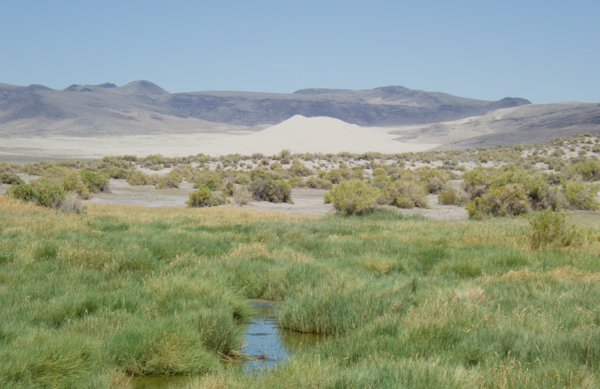

 

## Great Basin Appreciation

This ever-growing gallery of landscape photos attempts to convey just how remarkable the Great Basin is, yet it doesn't even begin to scratch the surface! The flora, wildlife, history, and solitude you can discover in this region are the biggest reasons why I have fallen in love with Nevada, but those are much more difficult to capture and do justice with a cellphone camera!


